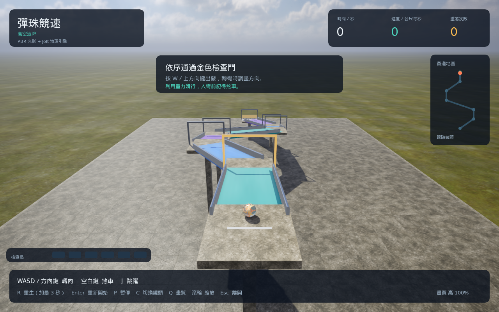

# 彈珠競速－高空速降

完全以 Aquarius（`.aqua`）撰寫的 3D 計時競速遊戲。操控玻璃彈珠沿著蜿蜒的高架賽道向下滾動，依序通過六道檢查門，挑戰自己的最佳紀錄。金色檢查門代表下一個檢查點，已通過的檢查門會變成綠色。墜落後會在上一個檢查點重生，並加罰 3 秒。

在 24 秒內完賽可獲得金牌，38 秒內則可獲得銀牌。最佳紀錄僅保留至本次遊戲關閉。遊戲介面、操作提示與視窗標題皆使用繁體中文。

## 遊戲預覽



繪圖透過 **Processing P3D 使用 wgpu**，搭配自訂 WGSL 的物理式渲染（PBR）。光照做法參考 `AquariusLangTW_Advanced_PBR_Example` 進階 PBR 範例專案：HDR 畫布、影像式環境光（IBL）、GGX 鏡面反射、split-sum 環境 BRDF，最後以 `image()` 色調映射輸出。Processing 負責 GPU 畫布呈現，以及 GLFW 視窗與輸入整合。

**Jolt Physics** 負責模擬彈珠與具有旋轉角度的方塊賽道，包含重力、摩擦、滾動、護欄碰撞及連續碰撞偵測。

### 寫實繪圖管線

- **HDR 場景**：整個場景畫在 `rgba16float` 離屏畫布，合成時在 HDR 空間做 FXAA，再套用 ACES 色調映射與暗角。亮部另以 1/4 解析度擷取並模糊成光暈。
- **材質**：GGX 法線分佈、Smith 可見度與 Schlick 菲涅耳。賽道是帶清漆的烤漆，中線有磨耗；護欄是異向性拉絲金屬；檢查門與終點拱門是陽極氧化金屬；平台與支柱使用 Poly Haven 掃描的混凝土貼圖（反照率、粗糙度、法線、AO）；遠處地面是草地與岩石貼圖。
- **環境光**：由 Poly Haven HDRI 烘焙 GGX 預濾波反射立方體（128 px、8 層 mip）、9 係數球諧漫射，以及環境 BRDF 近似。太陽已從 HDRI 移出，改以解析方向光計算，方向與照度取自原始 HDRI。天空用 RGBM 編碼的八面體貼圖繪製，並帶有太陽圓盤。
- **陰影與遮蔽**：賽道投在地面的陰影與環境遮蔽，在啟動時一次畫入遮罩貼圖，以 5 點 PCF 取樣。護欄、檢查門、平台與終點拱門投在賽道上的陰影以解析方式計算。彈珠的陰影與接觸遮蔽則以解析球體計算。
- **彈珠**：玻璃外殼帶清漆反射與菲涅耳，內部彩帶以光線步進繪製並寫入深度，滾動時會跟著旋轉。
- **大氣**：依距離混入環境色的霧，遠處地平線與天空自然銜接。

### 畫質與效能

按 **Q** 循環切換「自動／高／中／低」畫質，畫面上會顯示目前畫質與渲染比例。

- **自動**（預設）：持續量測平均畫格時間。超過 20.5 ms 時降低渲染解析度（最低 50%）；穩定低於 17.6 ms 時再逐步回升，中階電腦的瀏覽器也能維持流暢。
- 高／中／低的渲染像素上限約為 230 萬／130 萬／70 萬像素，因此 4K 或高 DPI 螢幕不會以原生解析度著色。低畫質關閉光暈、FXAA，以及檢查門與平台投在賽道上的陰影測試；中、低畫質減少彈珠內部的步進次數。
- 靜態幾何（賽道、護欄、支柱、平台、檢查門、終點線、地面）在啟動時合併成少數幾個保留式網格。每畫格的繪製呼叫從約 120 次即時方塊降為約 10 次，介面的靜態面板也快取在透明畫布，只在內容或尺寸改變時重繪。
- 物理維持 120 Hz 子步驟，但每畫格只呼叫一次 Jolt `步進(時間, 子步驟數)`。速度與旋轉在步進後快取，插值快照不再額外呼叫 Jolt。
- 在無頭 Chromium（軟體 WebGPU）的量測中，每畫格 CPU 時間中位數由約 34 ms 降為約 11 ms。

## 網頁版與 GitHub Pages

網頁版網址：[彈珠競速－高空速降](https://aquarius-language.github.io/AquariusLangTW_MarbleRun_3D/)（首次部署成功後即可使用）。請使用支援 WebGPU 的瀏覽器。

`web/` 包含已建置的遊戲、JavaScript 模組與 WebAssembly 相依檔案，可直接作為靜態網站發佈，不需要在 GitHub Actions 中重新編譯 Aquarius 腳本。

啟用部署：

1. 在儲存庫 **Settings → Pages → Build and deployment → Source** 選擇 **GitHub Actions**。
2. 將 `.github/workflows/pages.yml` 推送至 `main`。首次推送工作流程，以及後續 `main` 上的 `web/` 或工作流程更新，都會自動部署。
3. 亦可在 **Actions → Deploy game to GitHub Pages → Run workflow** 選擇 `main` 手動部署。成功後，`github-pages` 環境會顯示網站連結。

工作流程僅發佈 `web/` 的內容。修改 `.aqua` 來源後，請先重新建置網頁版並提交更新後的 `web/` 檔案，再部署網站。

## 建置與桌面執行

使用新版統一編譯器 `aqua.exe`：

```powershell
.\建置.ps1
aqua run .\marble_run.wasm
# 自包含桌面程式不需要另行安裝星泉或 .NET
.\dist\marble_run.exe
```

建置腳本只使用 PATH 中的 `aqua`，執行前請確認 `aqua` 指向最新版編譯器。桌面以 Wasmtime 執行，瀏覽器以原生 WebAssembly 執行相同程式；兩者共用 Jolt WASM。繪圖仍需要相容 GPU，中文字型使用 Microsoft JhengHei。

## 操作方式

| 按鍵 | 功能 |
| --- | --- |
| WASD／方向鍵 | 沿世界座標的 X／Z 軸轉向：W 朝賽道下坡方向移動，D 向右移動 |
| 空白鍵（按住） | 減緩水平移動速度 |
| J | 彈珠位於賽道上時跳躍 |
| R | 回到上一個檢查點，並加罰 3 秒 |
| Enter | 重新開始，保留本次遊戲的最佳紀錄 |
| P | 暫停／繼續物理模擬與計時 |
| C | 切換跟隨／俯瞰鏡頭 |
| Q | 切換畫質：自動／高／中／低 |
| 滑鼠滾輪 | 調整跟隨鏡頭距離 |
| Esc／關閉視窗 | 離開遊戲 |

按 W 或上方向鍵出發並開始計時。下坡速度主要來自重力；進入沒有護欄的彎道前先煞車，並朝醒目的金色檢查門前進。俯瞰鏡頭與小地圖可查看完整路線。兩種鏡頭模式的轉向方向都以世界座標為準。鏡頭與遊戲介面會隨視窗大小及顯示器像素密度調整。

## 腳本說明

| 腳本 | 職責 |
| --- | --- |
| `main.aqua` | 模組整合、繪圖生命週期、時鐘與事件連接 |
| `config.aqua` | 賽道節點、尺寸、物理參數與獎牌目標時間 |
| `math3d.aqua` | 向量運算，以及對應的四元數與矩陣轉換 |
| `track.aqua` | 共用的地板、護欄、支柱與檢查點定義（附材質種類） |
| `physics.aqua` | Jolt 資源管理、固定時間更新、操控、重生與成績計算 |
| `input.aqua` | 持續按鍵輸入與斜向轉向的正規化 |
| `camera.aqua` | 平滑跟隨視角、俯瞰視角與縮放 |
| `geometry.aqua` | 啟動時建立保留式網格（圓角護欄、帶 UV 的方塊）、地面陰影遮罩與遮擋體清單 |
| `shaders.aqua` | 產生 WGSL：PBR 場景、玻璃彈珠、HDR 天空、光暈與色調映射合成 |
| `environment.aqua` | 由 `tools/bake_assets.py` 產生：太陽方向與照度、球諧係數與貼圖尺寸 |
| `renderer.aqua` | HDR 畫布、貼圖載入、自動畫質、繪製順序與後製合成 |
| `hud.aqua` | 計時、進度、小地圖、操作提示、畫質、暫停與結果面板 |
| `smoke.aqua` | 使用原生繪圖與物理引擎的自動整合驗證 |
| `tools/bake_assets.py` | 下載 CC0 素材並烘焙 `assets/` 與 `environment.aqua`（需要 Python、NumPy、Pillow） |

專案自訂的變數、函式繫結、參數與著色器變數皆使用繁體中文名稱。Processing、畫布、著色器與 Jolt 的函式呼叫亦全部使用雙語 API 的繁體中文名稱（例如 `尺寸`、`建立畫布`、`套用矩陣`、`建立世界`、`步進`、`釋放`），名稱依據 [AquariusLangTW 雙語函式對照表](https://github.com/Aquarius-Language/AquariusLangTW/blob/main/AquariusDesktop/LIBRARY_NAMES.md)。模組名稱、常數、屬性、事件字串與 WGSL 入口及內建介面仍使用執行環境要求的原名。

修改 `config.aqua` 即可調整路線或移動參數。相鄰節點會建立具有旋轉角度的斜坡，寬大的平台則銜接各個轉角。碰撞體與繪圖幾何共用位置、尺寸及旋轉資料。檢查門、終點線與地面皆為裝飾。修改路線後，地面陰影遮罩與遮擋體會在啟動時自動重新計算。高架賽道下方的地面僅供顯示；彈珠落至回復高度以下時，就會觸發重生。

物理模擬透過時間累加器以 **120 Hz** 子步驟更新，同一畫格的子步驟合併為一次 Jolt 步進，繪圖時則使用位置插值。每個畫格的時間差上限為 0.1 秒，最多執行 12 個子步驟，避免長時間停頓後無限追趕進度。計時器累計模擬時間與重生罰時。煞車透過阻力減速；是否能跳躍由旋轉後的地板範圍判定，所有碰撞反應則由 Jolt 處理。抵達終點後，該次挑戰即停止更新。

正常離開時會釋放 Jolt 資源；若腳本或回呼發生錯誤，桌面執行環境也會釋放原生資源。Processing 會釋放視窗與 GPU 資源。

## 編譯與驗證

`建置.ps1` 會將所有模組及 WGSL 字串編譯至 `marble_run.wasm`，再輸出完整 `web` 網站，以及 `dist/marble_run.exe` 桌面程式。舊 `.bottle`／`.rius` 產物需重新編譯。

```powershell
aqua run marble_run.wasm --entry smoke.aqua
# 網頁需透過 localhost 或 HTTPS
python -m http.server 8080 --bind 127.0.0.1 --directory web
```

整合驗證使用真正圖學與 Jolt，檢查 HDR 畫布、四種畫質、轉向、煞車、跳躍、暫停、重生、檢查點、完賽、最佳紀錄及鏡頭。桌面驗證主視窗調整尺寸；網頁主視窗跟隨瀏覽器視口，離屏畫布尺寸仍由程式調整。

## 素材與重新烘焙

`assets/` 內的貼圖皆由 [Poly Haven](https://polyhaven.com/) 的 CC0 素材烘焙而成，可自由使用、無須標示：

| 素材 | 用途 |
| --- | --- |
| HDRI「kloofendal_48d_partly_cloudy_puresky」（Greg Zaal） | 天空、反射立方體、球諧漫射、太陽方向與照度 |
| 貼圖「concrete_floor_02」 | 平台與支柱（512 px） |
| 貼圖「aerial_grass_rock」 | 遠處地面（256 px） |

所有貼圖以 gzip 壓縮，共約 4.3 MB，透過 `aqua.toml` 的 `[[assets]]` 一併打包。若要更換 HDRI 或材質，修改 `tools/bake_assets.py` 開頭的設定後執行：

```powershell
python tools/bake_assets.py
```

腳本會把原始素材下載到 `tools/.cache/`（已列入 `.gitignore`），重新產生 `assets/*.gz` 與 `environment.aqua`。gzip 檔不含時間戳，相同輸入會得到相同檔案。

## 授權

本專案採用 [MIT 授權條款](LICENSE)。`assets/` 內的素材衍生自 Poly Haven 的 CC0 作品。


## Bottle / TOML project

The application is now an `aqua.toml` executable. Physics comes from the independent sibling `Aqua_JoltPhysics` 1.0.0 Bottle library, imported as `/bottles/Aqua_JoltPhysics/main.aqua`. Use an updated Aquarius compiler with ES-module DynamicLibrary support.

```powershell
aqua bottle install ../Aqua_JoltPhysics --global
aqua bottle restore --project .
aqua build . -o marble_run.wasm
aqua run marble_run.wasm
aqua build . --target web -o web
```

Commit `aqua.lock.json`. After the first install, `aqua build . --locked --offline` uses immutable cached package bytes. `建置.ps1` builds through the manifest for web/desktop/Android; source-only compilation does not resolve Bottle dependencies.
